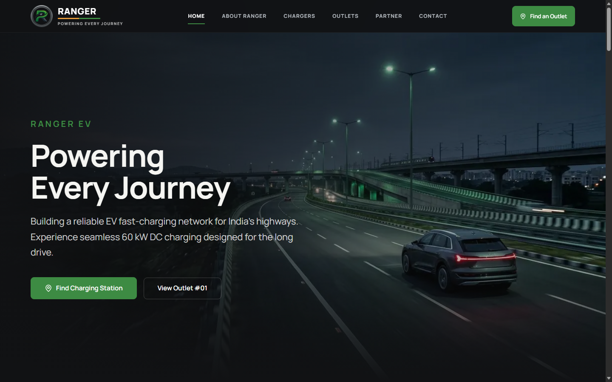
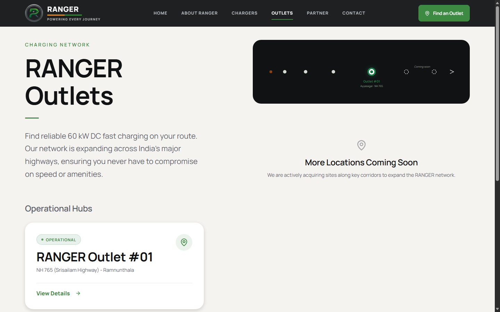
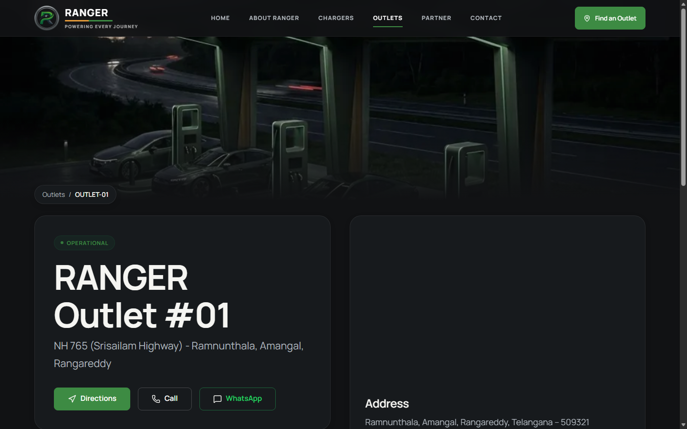
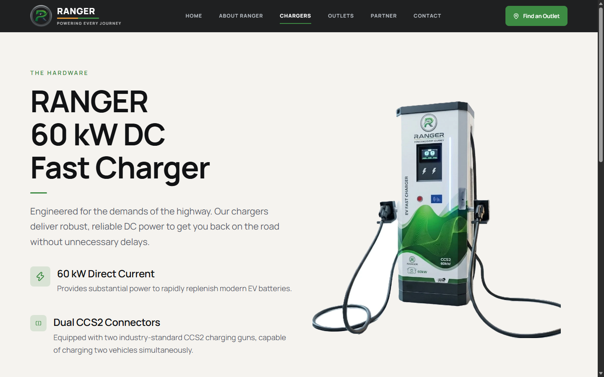
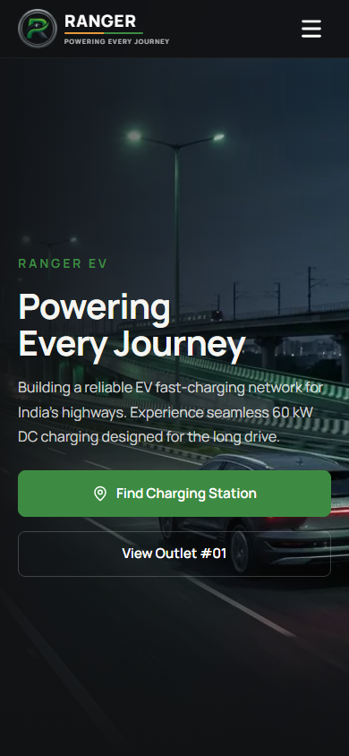
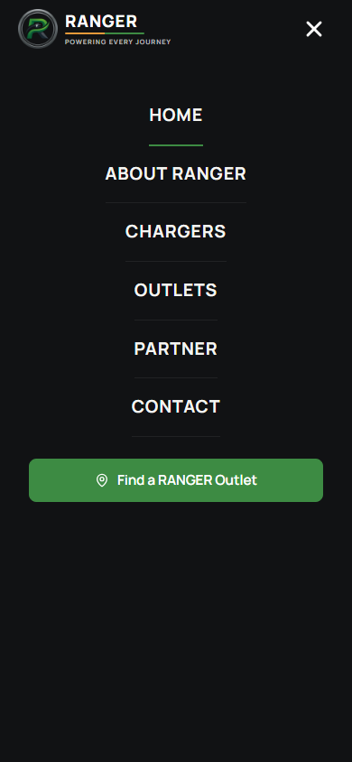

# RANGER EV HUB

[](https://react.dev/)
[](https://vitejs.dev/)
[](https://reactrouter.com/)
[](https://vitest.dev/)
[](https://eslint.org/)
[](#accessibility--inclusive-design)

> **High-Performance Highway EV Charging Network Platform**  
> Built for long-distance intercity electric vehicle mobility across India's national highways. Engineered with React 19, Vite 6, and responsive dark-mode architecture optimized for mobile Core Web Vitals, accessibility, and local SEO.

---

## Visual Preview

### Desktop Interface (1440px Viewport)

| Homepage & Fast-Charging Network | Highway Outlets Directory |
| :---: | :---: |
|  |  |

| Outlet Detail & Live Status | Dedicated Fast Chargers |
| :---: | :---: |
|  |  |

### Mobile Experience (390px Viewport)

| Responsive Mobile Homepage | Touch-Optimized Navigation Drawer |
| :---: | :---: |
|  |  |

---

## Key Features

- **Highway Corridor Network:** Real-time directory of 24/7 fast-charging stations along high-traffic routes (NH-44, NH-65, Outer Ring Roads) with real-time operational status, gun availability, and nearby amenities.
- **Dual-Gun 60kW DC & 3.3kW AC Charging:** Clear hardware specs, CCS2 connector compatibility, charging speed breakdowns, and turn-by-turn navigation links.
- **Route-Specific LCP Optimization:** Custom `<head>` discovery script preloads critical outlet hero images before route JavaScript chunks evaluate, slashing LCP resource discovery delay by 97.0% (527.5 ms → 16.0 ms).
- **Structured Data & Local SEO:** Imperative client-side SEO engine injecting canonical URLs, Open Graph tags, Twitter cards, and Schema.org JSON-LD (`AutoChargingStation`, `LocalBusiness`, `Organization`) on every route transition.
- **Accessible Design System:** Full WCAG 2.1 AA compliance across dark mode surfaces, custom focus rings, semantic landmark architecture, accessible form controls, and keyboard-trapped mobile drawer.
- **Production Form Validation:** Client-validated contact and partnership forms with automated honeypot spam traps, resilient network timeout handling, and accessible error messaging.
- **Zero Runtime CSS Bloat:** Engineered with custom CSS custom properties (variables), modern CSS Grid, and Flexbox layouts—no heavy UI framework runtime overhead.

---

## Modern Tech Stack

| Layer | Technology | Purpose |
| :--- | :--- | :--- |
| **Framework** | [React 19](https://react.dev/) (`19.2.8`) | Modern component model with automatic memoization and concurrent rendering |
| **Bundler & Dev Server** | [Vite 6](https://vitejs.dev/) (`6.4.5`) | Ultra-fast HMR and Rollup-powered production chunk splitting |
| **Routing** | [React Router v7](https://reactrouter.com/) (`7.18.2`) | Declarative client-side routing with route-level code splitting |
| **Icons** | [Lucide React](https://lucide.dev/) (`1.28.0`) | Lightweight, tree-shakeable SVG icons |
| **Test Runner** | [Vitest](https://vitest.dev/) (`5.0.5`) | Fast native ESM test runner with JSDOM environment |
| **Component Testing** | [@testing-library/react](https://testing-library.com/) (`16.3.3`) | User-centric DOM testing and regression verification |
| **Code Quality** | [ESLint 9](https://eslint.org/) (`9.39.5`) | Flat config with React Hooks & Refresh enforcement |
| **Asset Optimization** | [Sharp](https://sharp.pixelplumbing.com/) (`0.35.5`) | Automated script for WebP conversion and responsive asset scaling |

---

## Architecture & Codebase Layout

```
rangerev.com/
├── docs/                                # Technical documentation & reports
│   ├── performance-baseline.md          # Stage 5A-B 12-run Lighthouse baseline report
│   ├── performance-optimization-plan.md # Stage 5B-D & 5D-2B empirical optimization data
│   └── screenshots/                     # Desktop and mobile UI validation captures
├── public/                              # Static public assets
│   ├── images/                          # High-resolution optimized outlet & charger assets
│   ├── favicon.ico                      # Multi-size brand favicon
│   └── robots.txt                       # Search engine crawler directives
├── scripts/                             # Build & optimization scripts
│   └── optimize.cjs                     # Sharp image optimization pipeline
├── src/                                 # Application source code
│   ├── components/                      # Modular UI components
│   │   ├── Analytics.jsx                # GA4 SPA page-view router tracking
│   │   ├── Footer.jsx                   # Global footer with quick links & hours
│   │   ├── Navbar.jsx                   # Sticky header with mobile drawer toggle
│   │   ├── SEO.jsx                      # Dynamic document head & JSON-LD management
│   │   └── TransitionTicker.jsx         # Live highway network ticker
│   ├── data/                            # Static application datasets & contracts
│   │   ├── chargers.js                  # Charger specifications & connector types
│   │   ├── company.js                   # Brand metadata, contacts, and coordinates
│   │   └── outlets.js                   # Detailed highway station data & amenities
│   ├── pages/                           # Lazy-loaded route views
│   │   ├── About.jsx                    # Mission, vision, and team overview
│   │   ├── Chargers.jsx                 # Charging technology & hardware portfolio
│   │   ├── Contact.jsx                  # Direct messaging form & 24/7 support line
│   │   ├── Home.jsx                     # Network hero, features, and outlet preview
│   │   ├── NotFound.jsx                 # 404 fallback with primary navigation
│   │   ├── OutletDetail.jsx             # Station-specific details, maps & amenities
│   │   ├── Outlets.jsx                  # Searchable highway corridor station list
│   │   └── Partner.jsx                  # Landowner & franchise partnership portal
│   ├── services/                        # Business logic & integrations
│   │   └── formService.js               # Form submission client with retry & validation
│   ├── styles/                          # Styling architecture
│   │   └── index.css                    # Design tokens, theme variables, and global CSS
│   ├── config.js                        # Environment & domain configuration constants
│   ├── App.jsx                          # Route definition & layout wrapper
│   └── main.jsx                         # React 19 root mounting
├── tests/                               # Automated test suites (54 tests)
│   ├── config.test.js                   # Configuration & domain invariants
│   ├── formService.test.js              # Network request isolation & error handling
│   ├── outletsData.test.js              # Station dataset contract verification
│   ├── seo.test.jsx                     # DOM head mutation & metadata assertions
│   └── setup.js                         # Test environment initialization
├── eslint.config.js                     # ESLint 9 flat configuration
├── package.json                         # Dependencies and npm scripts
├── vercel.json                          # Single-page application routing rewrites
└── vite.config.js                       # Vite bundler, vendor chunking & Vitest setup
```

---

## Automated Testing Suite

The project includes **54 automated unit and integration tests** built on **Vitest** and **React Testing Library**:

```bash
npm run test
```

```text
 ✓ tests/formService.test.js (9 tests)
 ✓ tests/config.test.js (11 tests)
 ✓ tests/outletsData.test.js (19 tests)
 ✓ tests/seo.test.jsx (15 tests)

 Test Files  4 passed (4)
      Tests  54 passed (54)
```

### Coverage Highlights:
- **`config.test.js`**: Enforces strict URL structures, domain consistency, and valid business email formatting.
- **`outletsData.test.js`**: Verifies data contracts for every station (geographic latitude/longitude bounds, 24/7 hours, power capacity ratings, amenities array, valid image paths).
- **`formService.test.js`**: Asserts HTTP POST dispatch, Formspree API isolation, JSON headers, honeypot detection, and network error handling without making real network calls.
- **`seo.test.jsx`**: Validates imperative DOM mutations inside JSDOM: title updates, meta description creation, canonical link updates, and Schema.org JSON-LD tag generation.

---

## Performance & Core Web Vitals Optimization

The repository includes extensive real-world performance diagnosis and empirical audit history documented in [`docs/performance-optimization-plan.md`](docs/performance-optimization-plan.md):

1. **Route-Specific Image Discovery:**
   - On `/outlets/*` routes, a zero-dependency inline discovery script executes in `<head>` prior to route bundle loading.
   - Reduced mobile LCP resource load delay from **527.5 ms to 16.0 ms** (**97.0% improvement**).
2. **Vendor Chunk Isolation:**
   - Custom Rollup manual chunking in `vite.config.js` splits third-party libraries (`vendor-*.js`) from application route chunks, maximizing HTTP cache hit rates.
3. **Google Analytics (gtag.js) Architecture:**
   - Tested deferred analytics strategies (window load vs. idle scheduling) across 9-run controlled Lighthouse trials.
   - Retained early asynchronous loading to eliminate low-end mobile Total Blocking Time (TBT) spikes during user interactions and guarantee zero early-bounce data loss.

---

## Getting Started

### Prerequisites

- **Node.js**: `v20.x` or higher (verified on Node `26.x`)
- **Package Manager**: `npm` `v10.x` or higher

### Installation

```bash
# Clone the repository
git clone https://github.com/chandra8688/ranger-ev-website.git
cd ranger-ev-website

# Install dependencies
npm install
```

### Development

```bash
# Start local development server with HMR
npm run dev
```

The application will be available at `http://localhost:5173/`.

### Production Build & Preview

```bash
# Type check and build production bundle
npm run build

# Preview production build locally
npm run preview
```

### Code Quality & Testing

```bash
# Run ESLint across src/
npm run lint

# Run full Vitest suite
npm run test

# Run tests in watch mode
npm run test:watch
```

---

## License

Private repository — All rights reserved © RANGER EV.
