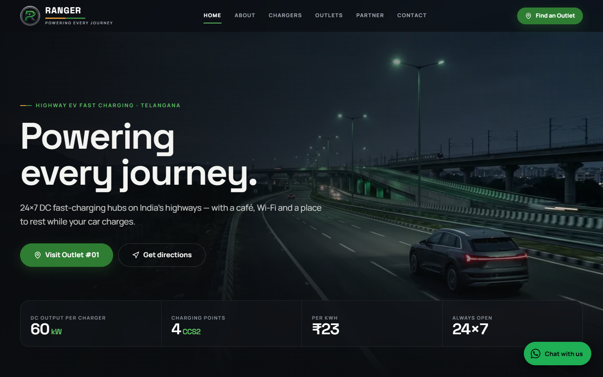
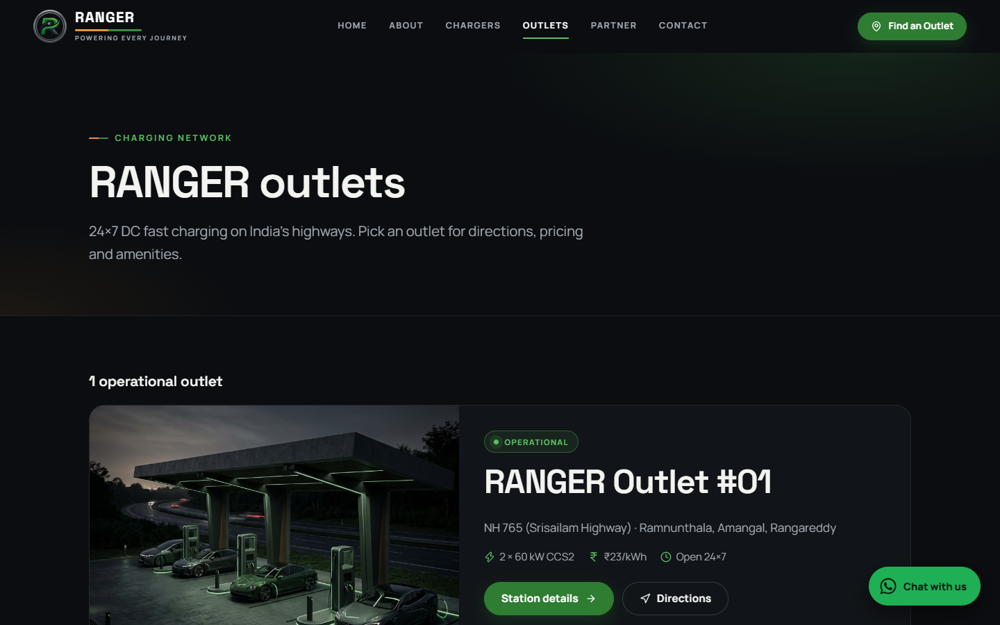
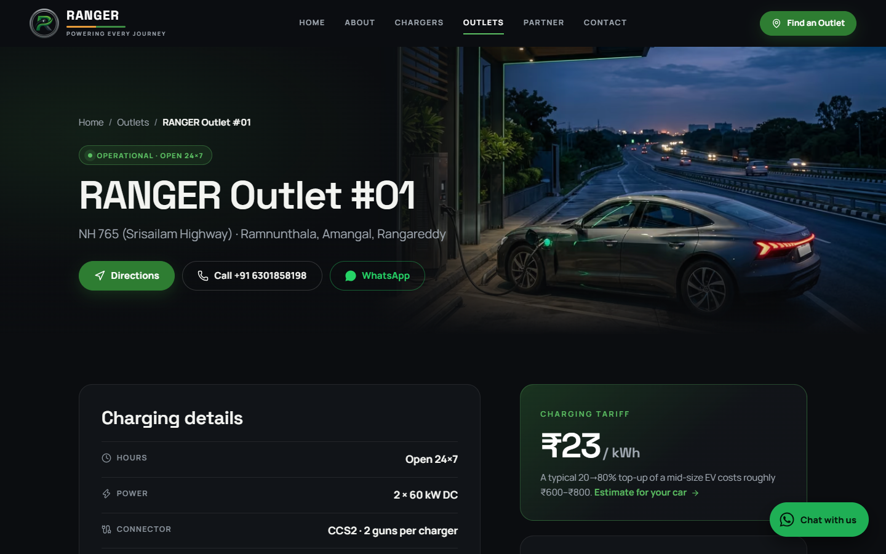
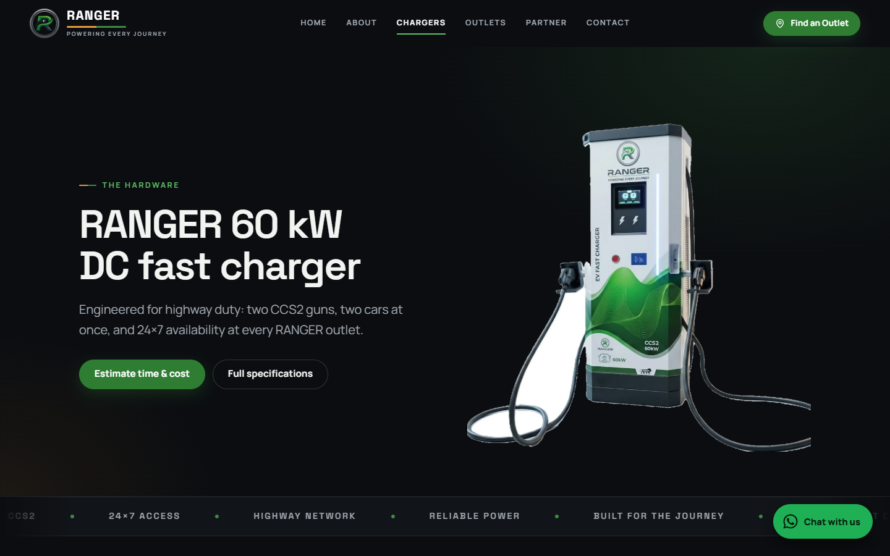
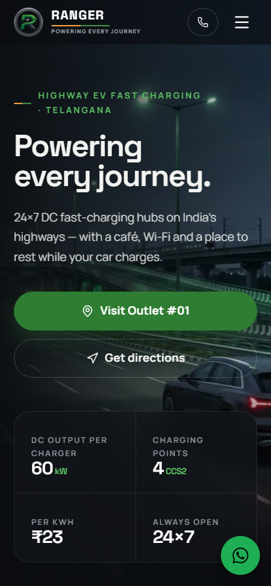
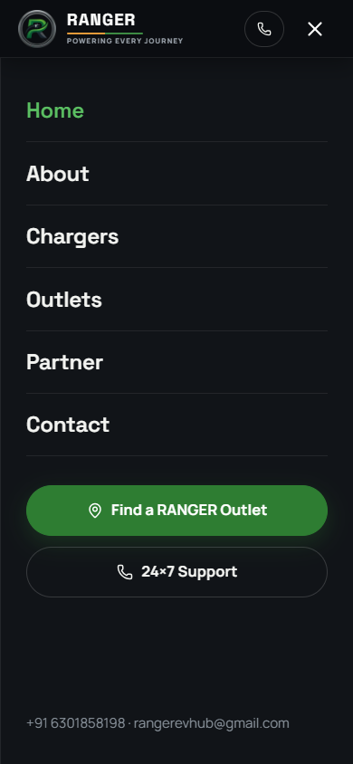

# RANGER EV HUB

[](https://react.dev/)
[](https://vitejs.dev/)
[](https://reactrouter.com/)
[](https://vitest.dev/)
[](https://eslint.org/)
[](#key-features)
[](https://ranger-ev-website.vercel.app)

> **Premium website for RANGER EV — 24×7 highway EV fast charging in India**
> RANGER builds DC fast-charging hubs on India's national highways, with a café, Wi-Fi and restrooms on site.
> Outlet #01 is live on NH 765 (Srisailam Highway): 2 × 60 kW DC CCS2 chargers, open 24×7, ₹23/kWh.
> Built with React 19 and Vite 6 as a fast, accessible, SEO-ready static site on Vercel.

**Live site:** https://ranger-ev-website.vercel.app

---

## Visual Preview

### Desktop Interface (1440px Viewport)

| Homepage | Outlets Directory |
| :---: | :---: |
|  |  |

| Outlet Detail | 60 kW DC Fast Charger |
| :---: | :---: |
|  |  |

### Mobile Experience (390px Viewport)

| Mobile Homepage | Navigation Drawer |
| :---: | :---: |
|  |  |

---

## Key Features

- **Outlet pages built for drivers:** tariff card (₹23/kWh), charging specs, amenities, a "RANGER experience" gallery with an accessible lightbox, an FAQ, and one-tap Directions / Call / WhatsApp (sticky on mobile).
- **Charging time & cost estimator:** pick a popular CCS2 car or enter a battery size, set arrival and target charge, and see an estimated time and cost. Every assumption is shown on the page.
- **Network map:** interactive Leaflet map of RANGER outlets, plus a click-to-load Google Map on each outlet page, so map scripts only load when someone asks for them.
- **Premium dark design system:** one token-based theme, Space Grotesk + Manrope variable fonts (self-hosted), cinematic AVIF/WebP imagery, scroll reveals and view transitions. Motion is turned off for visitors who prefer reduced motion.
- **Accessibility (WCAG 2.1 AA):** contrast checked on every page, a single `<main>` landmark, skip link, visible focus states, a mobile drawer with focus trap and Escape-to-close (`inert` while closed), and form errors and success messages announced to screen readers.
- **SEO & link previews:** every route ships its own prerendered `<head>` (title, description, canonical URL, Open Graph / Twitter tags, JSON-LD), so Google and WhatsApp / LinkedIn previews get the correct details without running JavaScript. Includes `ElectricVehicleChargingStation` with geo-coordinates, `FAQPage`, `ItemList`, `BreadcrumbList` and `Organization` data, an auto-generated sitemap, and real HTTP 404s for unknown URLs.
- **Forms:** contact and site-partnership forms (Formspree) with native validation, a honeypot plus timing spam check, and privacy consent text.
- **Privacy-first analytics:** GA4 with Consent Mode v2 and a cookie banner. Sends one `page_view` per route, plus conversion events (`click_directions`, `click_call`, `click_whatsapp`, `submit_contact_form`, `submit_partner_form`).
- **Installable & resilient:** PWA manifest and a service worker that keeps key pages available on patchy highway connections.
- **Hardened hosting:** enforced Content-Security-Policy, HSTS, X-Frame-Options, Referrer-Policy and Permissions-Policy, with one-year immutable caching for hashed assets.

---

## Modern Tech Stack

| Layer | Technology | Purpose |
| :--- | :--- | :--- |
| **Framework** | [React 19](https://react.dev/) (`19.2`) | Component model with concurrent rendering |
| **Bundler & Dev Server** | [Vite 6](https://vitejs.dev/) (`6.4`) | Fast HMR, route-level code splitting, path-based vendor chunking |
| **Routing** | [React Router v7](https://reactrouter.com/) (`7.18`) | Lazy-loaded routes and view transitions |
| **Maps** | [Leaflet](https://leafletjs.com/) (`1.9`) + OpenStreetMap | Network map, loaded only on `/outlets` |
| **Typography** | [Fontsource](https://fontsource.org/) variable fonts | Self-hosted Manrope + Space Grotesk (no Google Fonts request) |
| **Icons** | [Lucide React](https://lucide.dev/) (`1.28`) | Tree-shakeable SVG icons |
| **Forms** | [Formspree](https://formspree.io/) | Serverless form delivery behind `src/services/formService.js` |
| **Test Runner** | [Vitest](https://vitest.dev/) (`5.0`) + [Testing Library](https://testing-library.com/) | Unit and component tests in JSDOM |
| **Code Quality** | [ESLint 9](https://eslint.org/) | Flat config with React Hooks & Refresh rules |
| **Images** | [Sharp](https://sharp.pixelplumbing.com/) | Responsive AVIF/WebP, logo and Open Graph image generation |
| **Hosting** | [Vercel](https://vercel.com/) | Clean URLs, security headers, preview deployments |

---

## Architecture & Codebase Layout

```
ranger-ev-website/
├── assets-src/                          # High-resolution originals (not deployed)
│   ├── brand/                           # Logo source
│   └── cinematic/                       # Source imagery for the scene set
├── docs/
│   ├── context.md                       # Full project history & decisions
│   ├── performance-baseline.md          # Lighthouse baseline report
│   ├── performance-optimization-plan.md # Optimization experiments & data
│   └── screenshots/                     # README screenshots
├── public/
│   ├── images/scenes/                   # Generated AVIF/WebP scenes (640 & 1280 px)
│   ├── images/brand/                    # Right-sized logo (96 / 192 px WebP)
│   ├── manifest.webmanifest             # PWA manifest
│   ├── sw.js                            # Service worker (network-first pages)
│   └── robots.txt
├── scripts/
│   ├── prerender.mjs                    # Per-route <head>, 404.html and sitemap.xml after build
│   └── process-images.cjs               # Builds scenes, logo and OG images from assets-src/
├── src/
│   ├── components/                      # Navbar, Footer, SEO, Gallery, NetworkMap,
│   │                                    # ChargeCalculator, MapEmbed, FAQ, ConsentBanner, …
│   ├── data/                            # Single source of truth
│   │   ├── outlets.js                   # Stations, specs, tariff, amenities, imagery
│   │   ├── seo.js                       # Route metadata & JSON-LD (used by prerender too)
│   │   ├── scenes.js                    # Cinematic image set
│   │   ├── charging.js                  # Estimator presets & maths
│   │   ├── chargers.js · company.js · faqs.js
│   ├── lib/                             # analytics.js, useFormSubmit.js
│   ├── pages/                           # Home, About, Chargers, Outlets, OutletDetail,
│   │                                    # Partner, Contact, Privacy, NotFound (lazy-loaded)
│   ├── services/formService.js          # Formspree client
│   ├── styles/index.css                 # Design tokens & global styles
│   ├── config.js                        # Domain, analytics ID, defaults
│   ├── App.jsx                          # Layout, routes, consent, scroll handling
│   └── main.jsx                         # Root mount, fonts, service worker registration
├── tests/                               # 79 tests across 9 suites
├── vercel.json                          # Clean URLs, security headers, caching
└── vite.config.js                       # Build, chunking & Vitest config
```

---

## Automated Testing Suite

The project includes **79 automated unit and integration tests** built on **Vitest** and **React Testing Library**:

```bash
npm run test
```

```text
 ✓ tests/charging.test.js (6 tests)
 ✓ tests/config.test.js (11 tests)
 ✓ tests/forms.test.jsx (5 tests)
 ✓ tests/formService.test.js (9 tests)
 ✓ tests/navbar.test.jsx (5 tests)
 ✓ tests/outletsData.test.js (20 tests)
 ✓ tests/pages.test.jsx (3 tests)
 ✓ tests/seo.test.jsx (15 tests)
 ✓ tests/seoData.test.js (5 tests)

 Test Files  9 passed (9)
      Tests  79 passed (79)
```

### Coverage Highlights:
- **`navbar.test.jsx`**: drawer is `inert` while closed, opens with `aria-expanded`, closes on Escape and backdrop click, and returns focus to the toggle.
- **`forms.test.jsx`**: honeypot present, the first invalid field is focused, failures are announced via `role="alert"`, success via `role="status"`, and bot submissions are dropped.
- **`pages.test.jsx`**: outlet page shows the tariff and directions, unknown outlet IDs render the noindex 404, and pages never nest `<main>`.
- **`outletsData.test.js`**: data contract for every station, including coordinates, specs, tariff and that every referenced image variant exists on disk.
- **`seoData.test.js` / `seo.test.jsx`**: unique titles and descriptions, geo JSON-LD, ItemList, and correct head updates and clean-up between routes.
- **`charging.test.js`**: estimator maths, clamping and invalid-input handling.
- **`config.test.js` / `formService.test.js`**: domain and URL invariants, and Formspree request and error handling with mocked `fetch`.

---

## Performance & Core Web Vitals Optimization

Detailed audit history lives in [`docs/performance-optimization-plan.md`](docs/performance-optimization-plan.md) and [`docs/context.md`](docs/context.md).

1. **Per-route prerendered head:** `scripts/prerender.mjs` writes `about.html`, `outlets/outlet-01.html`, … with route metadata and a route-specific LCP image preload, so each page's hero image starts downloading before any JavaScript runs.
2. **Responsive imagery:** every scene ships as AVIF + WebP at 640/1280 px with explicit dimensions. Wide heroes never upscale beyond the source resolution.
3. **Lean loading:** Leaflet is split into its own chunk and loaded only on `/outlets`. Google Maps loads only on click. Fonts are self-hosted, and the navbar logo was cut from an 880 px PNG to 96/192 px WebP.
4. **Caching:** hashed `/assets/*` files are served `immutable` for a year, images for 30 days with stale-while-revalidate, and the service worker keeps key pages available offline.
5. **Analytics without double counting:** `send_page_view: false` plus a single `page_view` per route, sent after the page title is set.

---

## Getting Started

### Prerequisites

- **Node.js**: `v20.x` or higher (verified on Node `26.x`)
- **Package Manager**: `npm` `v10.x` or higher

### Installation

```bash
git clone https://github.com/chandra8688/ranger-ev-website.git
cd ranger-ev-website
npm install
```

### Development

```bash
npm run dev            # Vite dev server with HMR on http://localhost:3000
```

### Production Build & Preview

```bash
npm run build          # vite build + per-route prerender, 404.html and sitemap.xml
npm run preview        # serve dist/ locally
```

### Code Quality, Testing & Assets

```bash
npm run lint           # ESLint across src/
npm run test           # full Vitest suite
npm run test:watch     # watch mode
npm run process-images # regenerate scenes, logo and OG images from assets-src/
```

### Adding a new outlet

Add an entry to `src/data/outlets.js` and a 1200×630 link-preview image at `public/images/outlets/<id>/og-1200x630.jpg`. Its page, JSON-LD, sitemap entry, network-map pin and prerendered HTML are generated automatically on the next build.

---

## License

Private repository — All rights reserved © RANGER EV.
